# ThreatWatch — Architecture

This document explains how ThreatWatch is built and how data moves through it. It complements the [README](../README.md), which covers features, setup and deployment commands.

**Contents**

1. [System overview](#1-system-overview)
2. [Components](#2-components)
3. [Front-end structure](#3-front-end-structure)
4. [Start-up sequence](#4-start-up-sequence)
5. [Feed loading and merging](#5-feed-loading-and-merging)
6. [The CVE entry model](#6-the-cve-entry-model)
7. [Prioritisation: the Fix First queue](#7-prioritisation-the-fix-first-queue)
8. [Early warning and the intel worker](#8-early-warning-and-the-intel-worker)
9. [EPSS and exploit intelligence](#9-epss-and-exploit-intelligence)
10. [Rendering and UI state](#10-rendering-and-ui-state)
11. [Cloudflare console and AI agent](#11-cloudflare-console-and-ai-agent)
12. [Security model](#12-security-model)
13. [Deployment topology](#13-deployment-topology)
14. [Testing](#14-testing)
15. [Limits and trade-offs](#15-limits-and-trade-offs)
16. [Extending ThreatWatch](#16-extending-threatwatch)

---

## 1. System overview

ThreatWatch is a static single-page application with no build step and no application server. The browser does nearly all the work: it fetches the vulnerability feeds, merges and scores them, and renders the dashboard. Two small Cloudflare Workers fill gaps the browser cannot cover on its own:

- The **CORS proxy** relays requests to feeds that do not send CORS headers.
- The **intel worker** runs on a schedule. It collects early-warning data (new CVE.org records and upstream project advisories) and stores it in Workers KV so the dashboard can read it with one request.

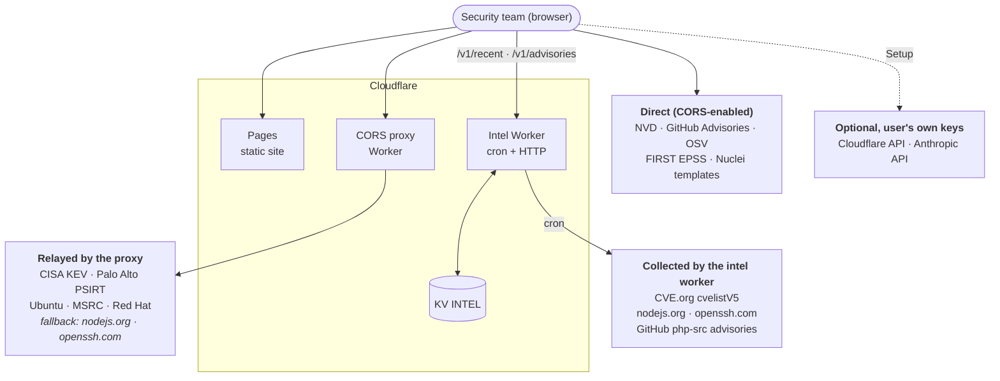

Design principles:

- **No backend state for users.** Settings live in the browser (`localStorage` for preferences, `sessionStorage` for API keys). The workers hold only public data.
- **Degrade, don't fail.** Every feed loads independently. If one is down its source pill shows `ERR`, and the rest of the dashboard keeps working. If the intel worker is down, the browser fetches the upstream advisories itself.
- **Treat every feed value as untrusted.** All feed text is escaped before it reaches the DOM, and URLs are checked (see [§12](#12-security-model)).
- **Pure logic is testable.** Scoring, merging, ranking and parsing are pure functions in `core.js` and `feeds.js`, covered by `node:test`.

---

## 2. Components

| Component | Location | Runs in | Responsibility |
|-----------|----------|---------|----------------|
| Markup | `index.html` | Browser | App shell, views, modals, detail panel |
| Styles | `css/app.css` | Browser | Colour tokens on `:root`, layout, responsive rules |
| Core helpers | `js/core.js` | Browser, Node tests | CVSS/severity, merging, sorting, priority tiers, core-software matching, CSV, URL hash state |
| Feed parsers | `js/feeds.js` | Browser, intel worker, Node tests | CVE.org delta log and records, Node.js, OpenSSH and PHP advisories, Nuclei IDs; normalise them to the entry model |
| Dashboard | `js/app.js` | Browser | Feed loaders, global state, rendering, Fix First view, detail panel, EPSS, search, exports, profile |
| Cloudflare console | `js/cloudctl.js` | Browser | Setup, Cloudflare views, WAF coverage, Claude agent loop and tools |
| Start-up | `js/main.js` | Browser | Event wiring, URL state, first load, auto-refresh |
| CORS proxy | `cors-proxy/worker.js` | Cloudflare Worker | Relays HTTPS GET/POST to allowlisted hosts for allowlisted origins |
| Intel worker | `intel-worker/worker.js`, `lib.js` | Cloudflare Worker, cron, KV | CVE.org ingestion, upstream advisories, `/v1/*` API |
| Tests | `tests/*.test.js`, `tests/fixtures/` | Node 22 | Unit tests against real-data fixtures |

---

## 3. Front-end structure

The front end uses classic `<script>` tags rather than ES modules, so every top-level declaration lives in one shared global scope. **Load order matters**: later files call functions defined in earlier ones.

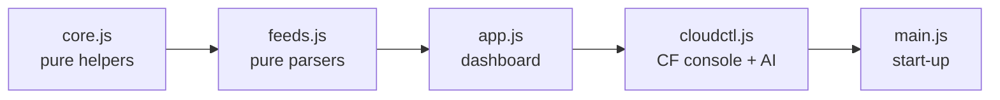

`core.js` and `feeds.js` end with `if (typeof module !== 'undefined') module.exports = {...}`. The same files therefore work as browser globals, as CommonJS for the Node tests, and as an import in the intel worker (the Wrangler bundler accepts CommonJS).

### Views

The app shell has a sidebar, an AI command bar and a view area. `showView(name)` switches between views:

| View id | Sidebar label | Purpose |
|---------|---------------|---------|
| `view-priority` (default) | FIX FIRST | Ranked remediation queue, tier tiles, early-warning banner |
| `view-threat-intel` | LIVE FEED | All loaded CVEs: stats, timeline, charts, filterable feed |
| `view-waf-coverage` | WAF COVERAGE | Critical/KEV CVEs joined against deployed WAF rules |
| `view-cf-*` | CLOUDFLARE … | DNS, WAF, firewall, Workers, Pages, analytics (needs Cloudflare keys) |

Two overlays sit above every view: the **CVE detail panel** (`openCveDetail(id)`) and the **AI drawer**.

### Key global state (`app.js`)

| Variable | Meaning |
|----------|---------|
| `allCves` | Every loaded entry, all sources merged and deduplicated by CVE ID |
| `currentRangeDays` | 7, 30 or 90; `-1` means a custom range |
| `_loadGen` | Load generation; a superseded load stops writing state |
| `epssCache` | `Map` of CVE ID → `{ epss, percentile }`, or `null` when FIRST has no score |
| `exploitIds` | `Set` of CVE IDs that have a public Nuclei template |
| `coreWatch` | `{ disabled, extra }` settings for the core software watch |
| `upstreamNotices` | Announced security releases, and OpenSSH advisories without a CVE |
| `prioTierFilter` | Fix First filter: `ALL`, `'1'`–`'4'` or `'early'` |
| `currentFilter`, `currentSourceFilter`, `currentSort`, `currentPage` | LIVE FEED filters |

---

## 4. Start-up sequence

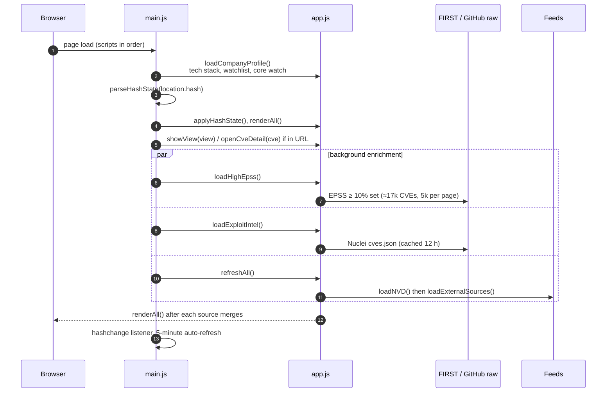

The 5-minute auto-refresh calls `refreshAll()`. It is skipped while a custom range or keyword search is active, because those loads are slow and rate-limited.

---

## 5. Feed loading and merging

### Refresh pipeline

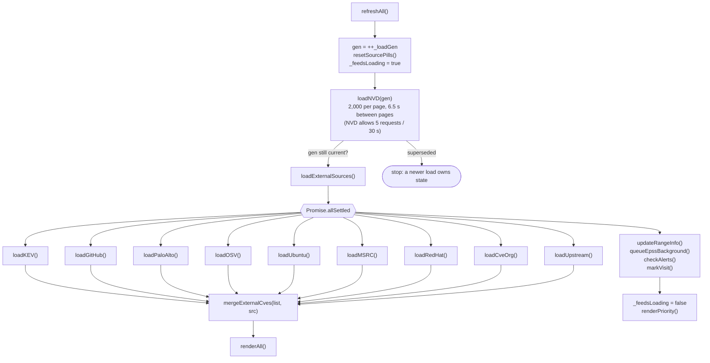

- **Supersede guard.** Changing the range while a long NVD load runs starts a new generation. The old load checks `gen !== _loadGen` between pages and stops writing, so a 30-day load can't overwrite a 7-day view.
- **Range filter.** `mergeExternalCves` drops entries dated outside the selected range. KEV entries are dated by `dateAdded`, upstream advisories by their publication date.
- **Source pills** show "in range / fetched" per source. A failed source shows `ERR` and logs the reason in the Activity Log.

### How each source is reached

| Source | Loader | Path | Notes |
|--------|--------|------|-------|
| NVD | `loadNVD` | direct | Paginated; on failure offers retry or labelled demo data |
| CISA KEV | `loadKEV` | proxy | Attaches the full KEV record (`_kev`: due date, required action, ransomware use) |
| GitHub Advisories | `loadGitHub` | direct | Unauthenticated: 60 requests per hour per IP |
| Palo Alto PSIRT | `loadPaloAlto` | proxy | |
| OSV | `loadOSV` | direct, proxy fallback | |
| Ubuntu | `loadUbuntu` | proxy | Kernel notices re-list hundreds of CVEs; see [§7](#7-prioritisation-the-fix-first-queue) |
| MSRC | `loadMSRC` | proxy | Latest monthly CVRF document |
| Red Hat | `loadRedHat` | direct, proxy fallback | |
| CVE.org | `loadCveOrg` | intel worker `/v1/recent` | Records minutes after publication, with CNA CVSS and CISA SSVC |
| Node.js, OpenSSH, PHP | `loadUpstream` | intel worker `/v1/advisories` → fallback `fetchAdvisoriesDirect()` | Fallback uses the proxy for Node.js and OpenSSH, and goes direct for PHP |

### Merging and deduplication

`mergeCves(existing, incoming)` in `core.js` deduplicates by CVE ID. A duplicate is never dropped silently; it **enriches** the existing entry:

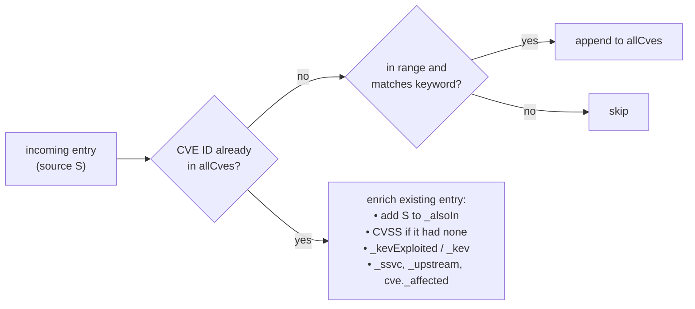

This is why a CVE first seen in NVD with no score can gain the CNA score from CVE.org, CISA's exploitation status from KEV, and a vendor advisory link from the Node.js feed.

---

## 6. The CVE entry model

Every source is normalised to the NVD 2.0 shape, with optional fields prefixed by `_`:

```text
{
  _source:       'nvd' | 'kev' | 'github' | 'paloalto' | 'osv' | 'ubuntu' | 'msrc' | 'redhat' | 'cveorg' | 'upstream'
  _alsoIn:       ['kev', 'cveorg', …]             other sources that reported the same CVE
  _kevExploited: true                              listed in CISA KEV (or CISA ADP KEV marker)
  _kev:          { dateAdded, dueDate, requiredAction, knownRansomwareCampaignUse, vendorProject, product }
  _ssvc:         { e: 'none'|'poc'|'active', a: 'yes'|'no', t: 'partial'|'total' }   CISA SSVC via CVE.org
  _upstream:     { product: 'Node.js'|'OpenSSH'|'PHP', severity, link, title }
  _demo:         true                              clearly labelled sample data
  cve: {
    id, published, lastModified,
    descriptions: [{ lang, value }],
    metrics:      { cvssMetricV40 | cvssMetricV31 | cvssMetricV30 | cvssMetricV2: [{ type, cvssData: { baseScore, vectorString, version } }] },
    weaknesses, references: [{ url, tags }], configurations (CPE),
    _affected:    ['openssh', 'Red Hat Enterprise Linux 9', …]   CVE.org / upstream products
    _cna:         'openbsd'                        CVE.org assigner
  }
}
```

Derived values are computed on demand, never stored: `getCvss()` (v4.0 → v3.1 → v3.0 → v2.0, NVD Primary preferred), `getSeverity()` (`0` means **UNSCORED**, never LOW), `getAffectedProducts()`, and `coreOf()` (memoised as `_core` / `_coreVer`).

---

## 7. Prioritisation: the Fix First queue

`rankByPriority(cves, epssLookup, ctx)` turns the merged list into an ordered remediation queue. Each CVE gets the **signals** from `prioritySignals()`:

| Signal | Source | Function |
|--------|--------|----------|
| Exploited | CISA KEV, CISA SSVC `active` | `_kevExploited`, `ssvcExploitation()` |
| Likely exploited | FIRST EPSS ≥ 10% | `epssCache` |
| Public exploit | Nuclei template > CISA SSVC `poc` > NVD reference tagged *Exploit* | `publicExploitSource()` |
| Core software | CPE, package name or narrow description match | `coreSoftwareOf()` |
| Remote, no auth | CVSS vector `AV:N` + `PR:N`, or SSVC automatable | `isRemoteNoAuth()` |
| Early warning | core + remote + published < 72 h | `prioritySignals().early` |

### Tier decision

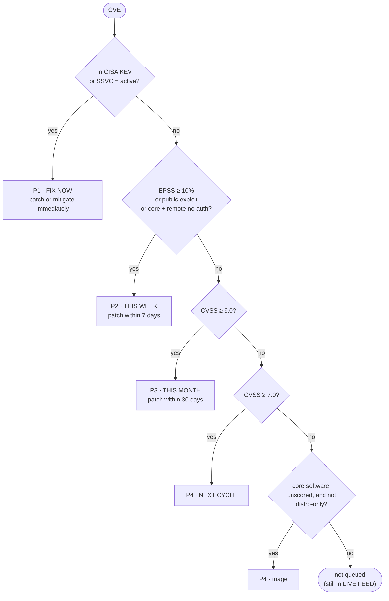

**Order within a tier:** known ransomware use → early warning → exploit strength → EPSS → CVSS → newest. Each row keeps its `reasons[]`, shown as "Why:" in the queue, the detail panel, the CSV and the AI context.

**Why "not distro-only".** Linux kernel CVEs from the kernel CNA arrive unscored, so without a triage rule they would vanish from the queue. But a single Ubuntu kernel notice re-lists hundreds of older CVEs; one live 7-day sample had 4,589 of them. Those are one patch action, not new disclosures, so `isDistroOnly()` keeps them out of triage. They stay visible in LIVE FEED.

### Core software watch

`CORE_SOFTWARE` lists OpenSSH, the Linux kernel, PHP, Node.js, OpenSSL, glibc, sudo, nginx, Apache httpd, curl, xz and systemd. Each entry matches by:

1. CPE `vendor:product` (e.g. `openbsd:openssh`),
2. package or product name (e.g. `linux`, `php-src`), or
3. a narrow description phrase (e.g. "in PHP before 8.3.20"), so that a WordPress plugin that "requires PHP" or an npm library "for Node.js" does not match.

Users can switch built-ins off and add their own keywords in Company Profile. Settings are stored in `localStorage` as `tw_core_watch`.

---

## 8. Early warning and the intel worker

AI-assisted vulnerability research and exploit development shorten the time between disclosure and attack. The established signals lag behind: NVD analysis can take days, EPSS starts new CVEs low, and KEV requires confirmed exploitation. The intel worker closes that gap with sources that publish first.

### Worker layout

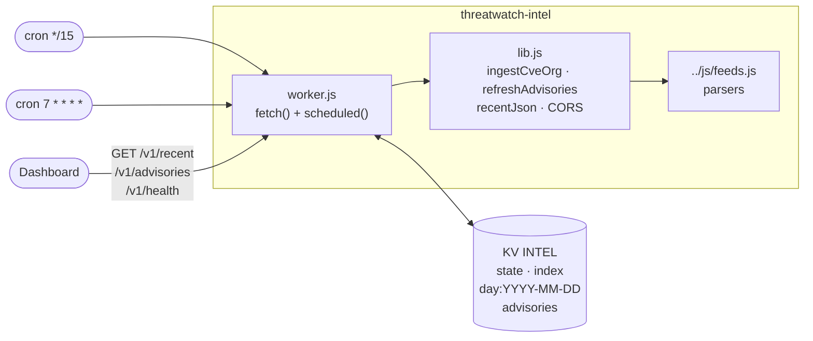

`worker.js` exports only the handler object, because the Workers runtime rejects any other module export. All logic lives in `lib.js`, which the tests import directly.

### CVE.org ingestion (every 15 minutes)

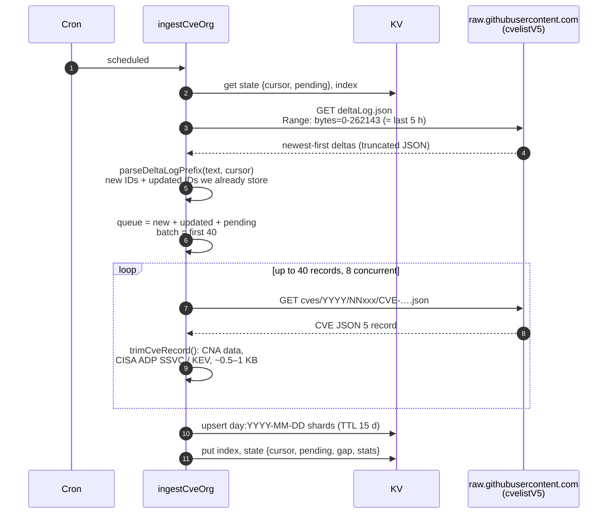

- **Range read.** `deltaLog.json` is about 37 MB. Its newest entries come first, so reading the first 256 KB is enough for each run. The worker asks for a byte range *and* stops reading after 256 KB (`readPrefix()`), because a server may ignore the range and send the whole file; `/v1/health` reports the HTTP status as `stats.deltaHttp`.
- **Cursor.** `state.cursor` is the newest `fetchTime` already processed. If the cursor is no longer inside the window that was read (the worker was down for hours), `state.gap = true` and `/v1/health` reports it.
- **Updates matter.** CISA adds SSVC assessments to a record after it is published. Updated IDs that are already stored are re-fetched, so an exploitation status of `poc` or `active` reaches the dashboard.
- **Free-plan limits.** 1 + 40 subrequests per run (the limit is 50). Day shards stay small, so a run parses little JSON, and there are about 200 KV writes a day (the limit is 1,000).
- **HTTP 404** (record not mirrored yet, or rejected) drops the ID. **5xx and network errors** re-queue it for the next run.

### Upstream advisories (hourly at :07)

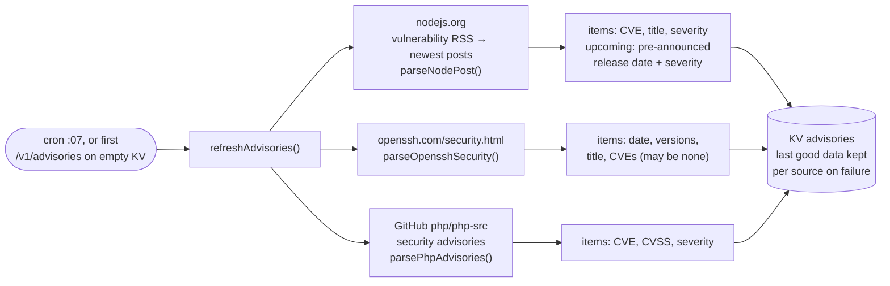

Node.js announces security releases about a week ahead, giving the date and highest severity but no CVE IDs. The dashboard shows these in the early-warning banner ("Node.js security release Wed, Nov 11 — highest severity HIGH"), so the patch window can be planned before the details are public.

### Dashboard side

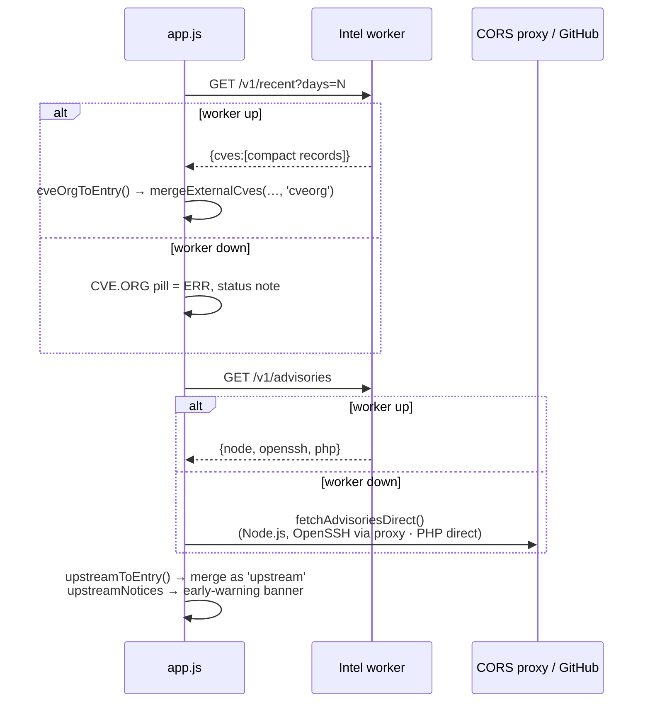

---

## 9. EPSS and exploit intelligence

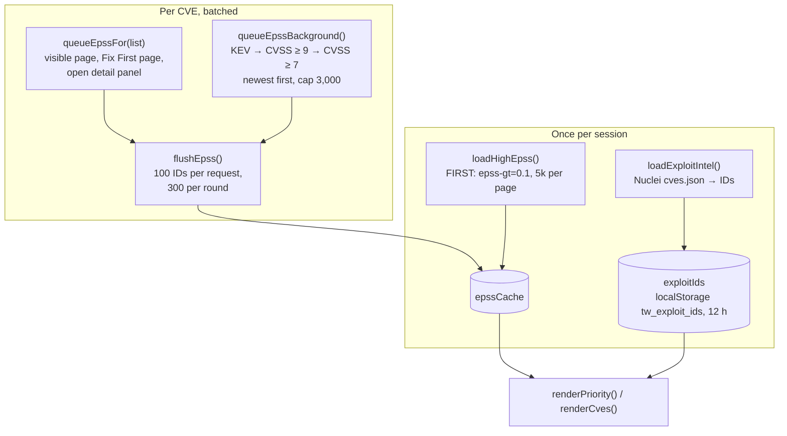

The bulk EPSS load makes "absent from the set" meaningful: a CVE not in `epssCache` after the bulk load is known to be below 10%, and the UI shows `<10%` while its exact value loads.

---

## 10. Rendering and UI state

- **`renderAll()`** coalesces calls with a 30 ms timer and then runs `renderNow()`, which renders Fix First, the feed, the stats, the timeline, the charts and the open detail panel. Loaders call `renderAll()` freely.
- **No inline handlers built from feed data.** Rows carry `data-cve-id`, and one delegated listener per container (`onCveListActivate`) handles click and Enter.
- **Shareable URL state.** `syncHash()` writes the state into `location.hash`, and `applyHashState()` restores it on load and on `hashchange`. Values are validated against allowlists in `parseHashState()`, and defaults are omitted.

```text
#range=30&sev=CRITICAL&src=kev&sort=epss&page=2&new=1&watch=1&view=threat-intel&pt=early&cve=CVE-2026-12345
```

| Key | Values |
|-----|--------|
| `range` | `7`, `30`, `90`, `custom` (+ `from`, `to`, `kw`) |
| `view` | `priority` (default, omitted), `threat-intel`, `waf-coverage`, `cf-*` |
| `pt` | Fix First filter: `1`–`4`, `early` |
| `sev`, `src`, `sort`, `page`, `new`, `watch` | LIVE FEED filters |
| `cve` | open detail panel |

### Browser storage

| Key | Store | Content |
|-----|-------|---------|
| `tw_company_profile` | localStorage | name, tech stack, company mode, watchlist, notifications |
| `tw_core_watch` | localStorage | core software watch settings |
| `tw_last_visit` | localStorage | timestamp for NEW badges |
| `tw_exploit_ids` | localStorage | Nuclei CVE IDs, refreshed every 12 h |
| `tw_ai_model` | localStorage | selected Claude model |
| `tw_notified_kev` | localStorage | KEV IDs already notified |
| `tw_intel_url` | localStorage | optional intel worker override for local development |
| `cf_token`, `anthropic_key`, … | sessionStorage | API keys; cleared when the tab closes |

---

## 11. Cloudflare console and AI agent

The console is optional and only active after the user enters keys in **Setup**. Cloudflare API calls go directly from the browser, or through a user-provided bridge Worker (`CF_BRIDGE_URL`), because the Cloudflare API sends no CORS headers.

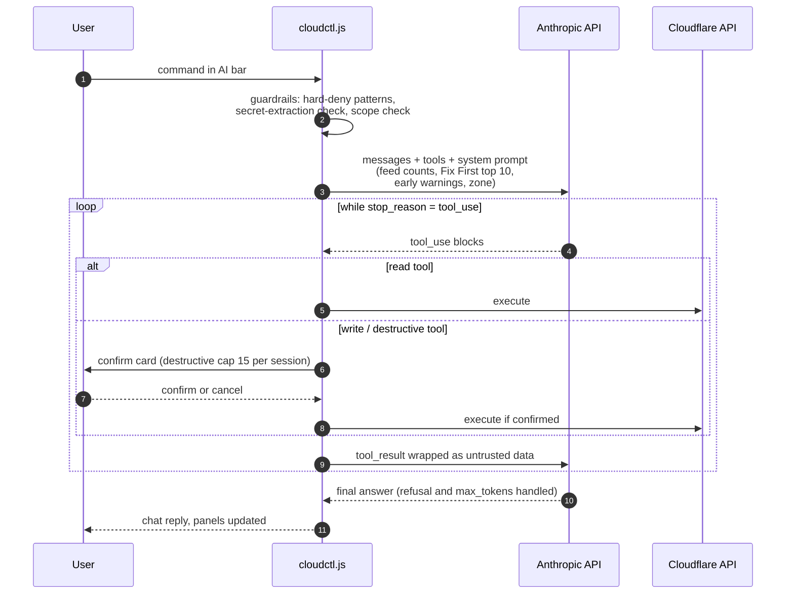

- **Models:** Sonnet 5.5 by default; Opus 5.5 or Haiku 5.5 can be selected in Setup. `max_tokens` is 16,000.
- **Tools:** 20 tool definitions covering DNS, WAF, IP access rules, zone settings, analytics, Workers, Pages, cache purge and bot management, classed as `read` (8), `write` (7) or `destructive` (5). Only `read` tools run without a confirmation.
- **WAF coverage** (`renderWafCoverage`) joins critical/KEV CVEs to deployed WAF rules by keyword. It is a triage signal, not a scanner. The detail panel reuses `_lastWafRules`.

---

## 12. Security model

| Threat | Mitigation |
|--------|-----------|
| XSS from feed content (descriptions, titles, vendor names, URLs) | `escapeHtml()` on all text and attributes; `safeUrl()` allows only `http(s)` hrefs; `data-*` attributes and delegated listeners instead of inline handlers built from feed data. Verified with a script-tag payload in the feed, detail panel, Fix First and early-warning banner. |
| Spreadsheet formula injection in exports | `csvCell()` prefixes `= + - @ \t \r` with `'` and quotes every cell |
| Open proxy abuse | The CORS proxy accepts only HTTPS targets on `ALLOWED_HOSTS` (exact host or a real subdomain, so `evilubuntu.com` ≠ `ubuntu.com`) and answers only `ALLOWED_ORIGINS` |
| Intel worker abuse | Read-only public data, GET only, origin allowlist (others get 403), cached responses, bounded `days` parameter |
| API key exposure | Keys stay in `sessionStorage`, are sent only to their own APIs, and are never in the URL; the AI prompt forbids echoing them and a regex pre-filter blocks extraction attempts |
| Prompt injection via CVE text or Cloudflare data | Tool results are wrapped as untrusted data; write and destructive tools always need human confirmation; there is a per-session cap on destructive actions |
| Malicious URL hash | `parseHashState()` validates every key against allowlists or regexes |

---

## 13. Deployment topology

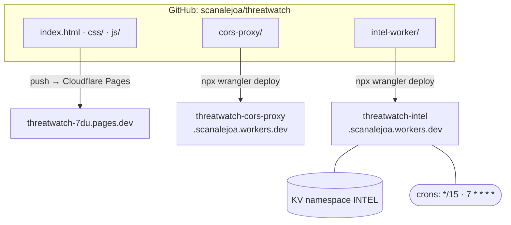

- **Pages** serves the static files; there is no build command.
- **The workers deploy independently.** Redeploy the proxy when `ALLOWED_HOSTS` changes. The intel worker needs its KV namespace id in `intel-worker/wrangler.toml`.
- **URLs are constants:** `CORS_PROXY` and `INTEL_API` in `js/app.js`. Change them if the workers.dev subdomain differs.
- **Allowed origins** (production domains plus `localhost:3000`) appear in both workers. Keep them in sync.

---

## 14. Testing

```bash
npm test     # node --test "tests/*.test.js"
```

| Suite | Covers |
|-------|--------|
| `tests/core.test.js` | escaping, CVSS selection, severity, merge/enrichment, sorting, CSV, hash state, timeline buckets, priority tiers, core-software matching (including false positives), exploit signals, early warning, distro exclusion |
| `tests/feeds.test.js` | CVE.org delta log (truncated), record trimming with CISA SSVC, Node.js RSS, release posts and pre-announcements, OpenSSH page, PHP advisories, Nuclei IDs |
| `tests/intel-worker.test.js` | ingestion cursor, per-run cap, retry vs drop, gap detection, advisories with last-good fallback, HTTP CORS, endpoints, first-request fill |
| `tests/worker.test.js` | CORS proxy host allowlist and request validation |

Fixtures in `tests/fixtures/` are trimmed copies of real responses. When a source changes its format, refresh the fixture and adjust the parser in `js/feeds.js`. Both the browser and the worker pick up the change.

Run the intel worker locally with `npx wrangler dev --test-scheduled`, and trigger crons via `/__scheduled?cron=…` (see `intel-worker/README.md`).

---

## 15. Limits and trade-offs

- **NVD rate limit:** 5 requests per 30 s without a key. Long ranges load page by page, and custom ranges longer than 90 days require a keyword.
- **Browser memory:** a 90-day load holds tens of thousands of entries. Rendering is paged at 50 rows, and Fix First shows 25 rows with "show more".
- **CVE.org history:** a fresh worker sees only the last ~5 hours, then builds a 14-day window. Older CVEs come from NVD and the other feeds.
- **Advisory parsing** depends on the HTML structure of nodejs.org and openssh.com. Parsers are fixture-tested and fail per source (last good data is kept).
- **GitHub unauthenticated limits:** 60 requests per hour per IP for the GitHub Advisories and php-src APIs.
- **Matching is heuristic.** Core-software and WAF-coverage matching use CPEs, package names and phrases. Treat them as a triage aid, not an asset inventory.
- **Suggested SLAs** (immediately / 7 / 30 days / next cycle) are guidance. Adjust them to your policy in `PRIORITY_TIERS` (`core.js`).

---

## 16. Extending ThreatWatch

**Add a feed**

1. Write `loadX()` in `app.js`. Normalise each item to the entry model ([§6](#6-the-cve-entry-model)) with `_source: 'x'`, then call `mergeExternalCves(list, 'x', fetchedTotal)`. Call `setSourceStatus('x', false)` on failure.
2. Add it to `loadExternalSources()`, add a pill `#src-x` and a source tab in `index.html`, and add `'x'` to `HASH_ALLOWED.src` in `core.js`.
3. If it needs the proxy, add the host to `ALLOWED_HOSTS` in `cors-proxy/worker.js`, add a test, and redeploy.
4. Put any parsing in `js/feeds.js` with a fixture test, so the intel worker can reuse it.

**Add a core package:** append to `CORE_SOFTWARE` in `core.js` (`key`, `label`, `cpe`, `pkg`, `re`) and add a positive and a false-positive case to `tests/core.test.js`.

**Change the ranking:** edit `prioritySignals()` and `rankByPriority()` in `core.js`, update the `PRIORITY_TIERS` text (shown in the UI, CSV, PDF and AI context), and extend the priority tests.

**Add an upstream advisory source:** write a parser in `feeds.js`, add a job in `refreshAdvisories()` (`intel-worker/lib.js`) and in `fetchAdvisoriesDirect()` (`app.js`), and map the product in `loadUpstream()`.
